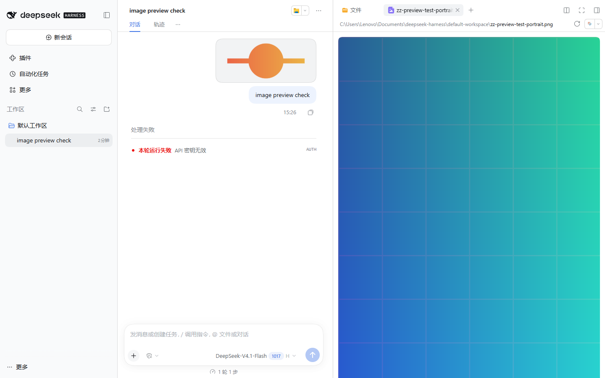
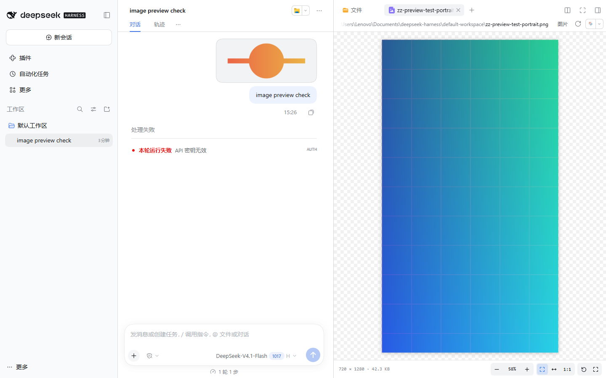
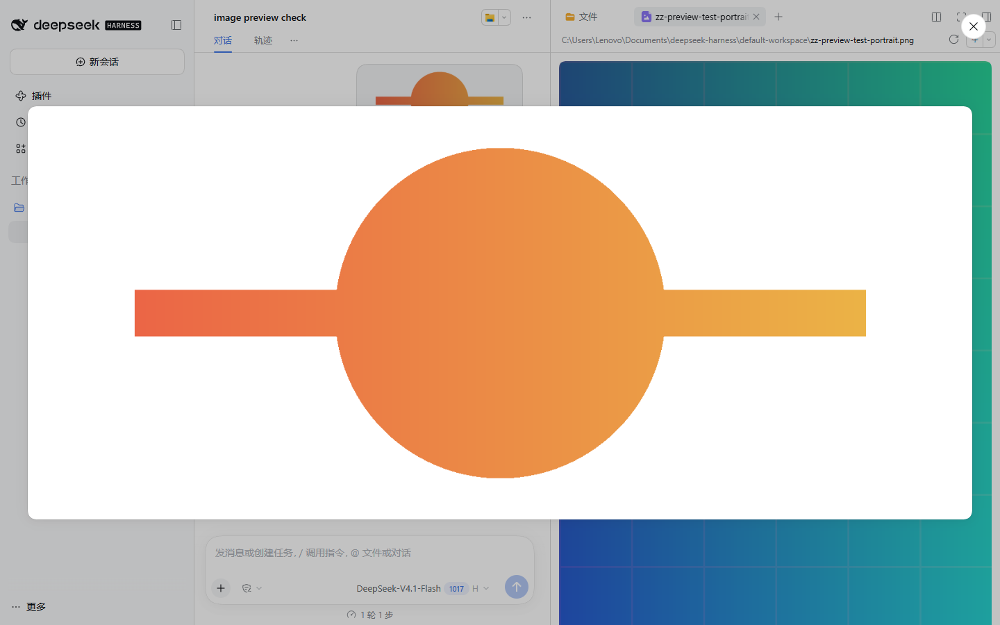
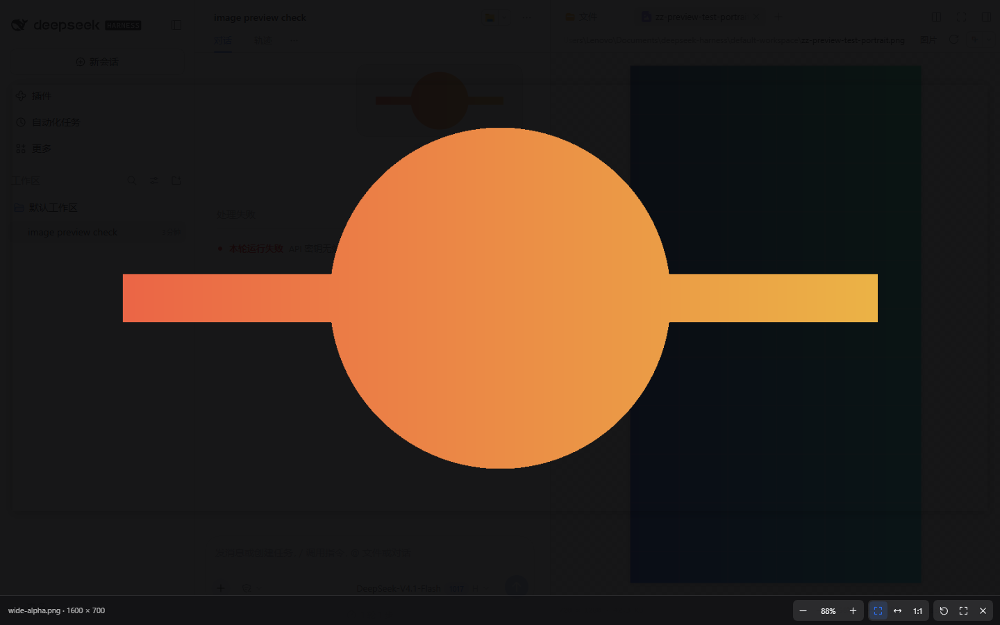
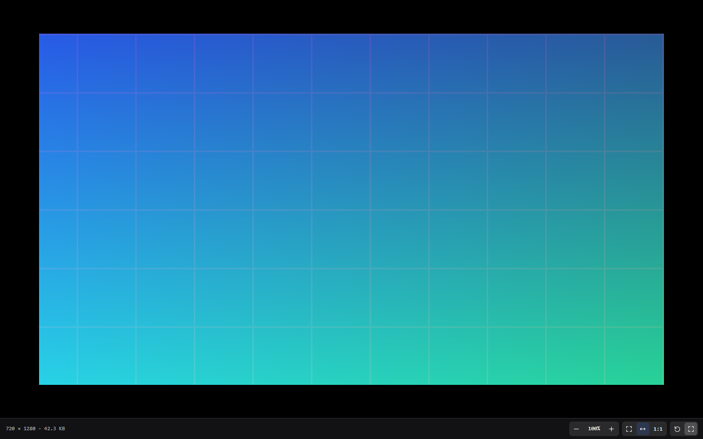
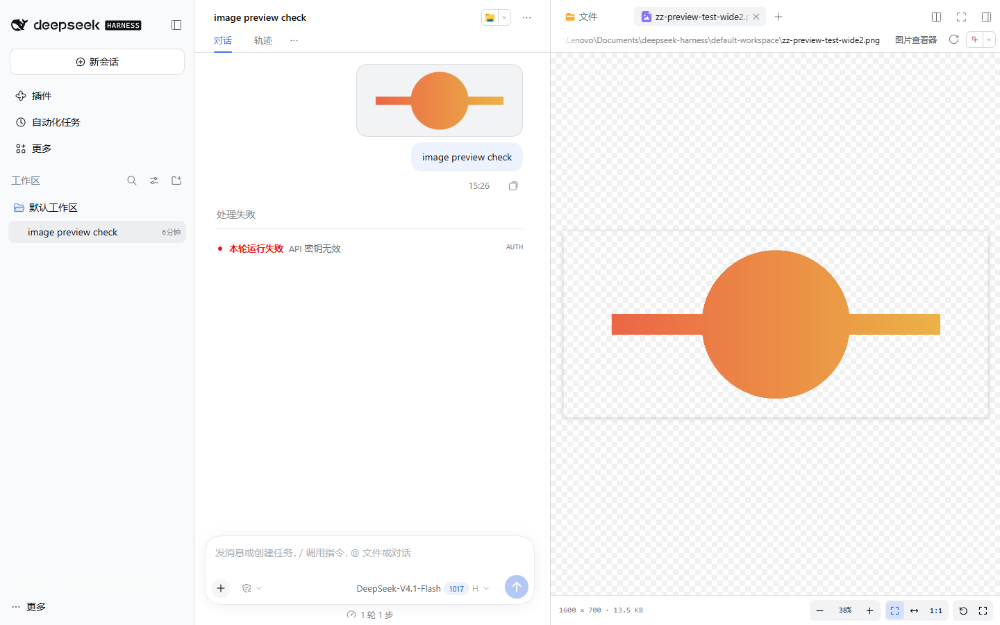

# dsh-preview-image

Image preview for [DeepSeek Harness](https://github.com/deepseek-ai/deepseek-harness) with **real zoom, pan, rotation and full screen** — in the right-Sidebar document preview and in the conversation lightbox.

**English** (this file) · [中文](README.zh.md)

## Why

DeepSeek Harness already renders image files, but the two previews it ships are deliberately minimal:

- The document-preview image renderer zooms only through a floating control that appears when the pointer enters the bottom strip of the pane; it has fit-width/fixed-scale choices, no rotation, and no full screen.
- The conversation lightbox renders the original at fit-to-viewport size only — the attachment package's own documentation lists “No zoom or download in the lightbox” as a limitation.

This plugin replaces both surfaces with one viewer: an always-visible toolbar with zoom, fit modes, 100%, rotation and full screen, plus wheel/drag/keyboard gestures. The built-in renderer stays available from the preview's **Open with** menu, and SVG keeps its plain-text option.

## Install

```sh
dsh plugin --profile <profile> add dsh-preview-image
```

Restart the desktop app (a profile patch change is read at boot). No configuration is required.

The `desktop` profile is managed by the Electron app, so `dsh plugin --profile desktop add …` is rejected there; install through the app's plugin manager for desktop. The command above applies to custom profiles.

To check it loaded, open any image from the Files tab: the pane shows the toolbar instead of the bare built-in image view. Clicking an image in the conversation (or on a composer attachment) opens the zoomable lightbox instead of the built-in one.

## Before / after

Same session, same workspace, same 1440×900 light-theme viewport. The “before” profile is `@deepseek-ai/dsh-base` + `@deepseek-ai/dsh-web-app`; the “after” profile adds this plugin.

### Document preview

| Before — built-in image renderer | After — dsh-preview-image |
|---|---|
|  |  |

The built-in view fills the pane with the image and hides zoom controls; the plugin adds a persistent toolbar, metadata (720 × 1280 · 42.3 KB), a checkerboard behind transparency, and explicit controls.

### Conversation lightbox

| Before — built-in lightbox, fit only | After — zoomable lightbox |
|---|---|
|  |  |

### Full screen and transparency

| Full screen (maximize control) | Transparent image over the checkerboard |
|---|---|
|  |  |

## What it does

- **Document renderer** — registers `dsh-preview-image/viewer` for `png`, `jpg`, `jpeg`, `jfif`, `gif`, `webp`, `avif`, `bmp`, `ico`, and `svg` at `priority: "extension"` with `loading: "bytes-complete"`. Bitmaps are declared binary so the plain-text fallback is not offered; SVG stays text-readable and keeps that option.
- **Conversation lightbox** — a click captured on images inside `conversation.chat.user.images`, `conversation.chat.message.images`, `conversation.trajectory.images`, `tool.call.images`, and `conversation.input.attachments` opens the plugin's viewer instead of the built-in lightbox. The overlay closes on Escape, a background click, or the close button, and restores focus to the image button that opened it.
- **Controls** — zoom out, current percentage (click for 100%), zoom in, fit to window, fit width, 1:1, rotate 90°, full screen, close (lightbox). The toolbar is always visible and wraps on narrow panes; metadata shows the intrinsic size and, in the document preview, the file size.
- **Gestures** — drag to pan, mouse wheel to pan, Ctrl/⌘+wheel to zoom at the pointer, double-click to alternate fit and 100%. Chromium maps a trackpad pinch to the same Ctrl+wheel path.
- **Keyboard** — `+`/`-` zoom, `0` fit, `1` 100%, `R` rotate, `F` full screen, arrow keys pan, `Esc` leaves full screen or closes the lightbox. The document viewer takes keys while it has focus; the lightbox listens at the window.
- **Full screen** — the Fullscreen API on the viewer root; if the deployment refuses it, the viewer falls back to a fixed overlay that Escape dismisses. `Esc` also calls `exitFullscreen()` itself so the shortcut works even where the browser's default handling is suppressed.
- **Pan bounds** — a fitted image stays fully visible inside the pane; a zoomed or rotated image cannot be dragged past its own edges, so it can never be lost off-screen.
- **Transparency** — a low-contrast checkerboard behind the stage makes alpha visible.

## Controls

| Action | Button | Pointer | Keyboard |
|---|---|---|---|
| Zoom in / out | − / + | Ctrl/⌘+wheel | `+` / `-` |
| Pan | — | drag, wheel, Shift+wheel | arrows |
| Fit to window | fit icon | double-click | `0` |
| Fit width | ⇔ icon | — | — |
| Actual size (100%) | percentage chip / `1:1` | double-click | `1` |
| Rotate 90° | ↻ icon | — | `R` |
| Full screen | ⤢ icon | — | `F` |
| Close lightbox | × | background click | `Esc` |

## Configuration

None. The suffix list, zoom range (2%–1600%), and step (1.25×) are constants in `lib/client.js`.

## How it is built

```
lib/index.js    Host entry: name / inject / apply (client-only, no routes)
lib/client.js   Hand-written module-loader bundle: renderer, body, lightbox, styles
test/           node --test: bundle wiring, pure zoom/pan math, package shape
scripts/        Headless browser end-to-end driver used for verification
docs/           Before/after screenshots
```

The browser half is a classic `window.__ModuleLoader__.load({ id, factory })` bundle that requires only `react` (plus `react-dom` for the body portal), so it needs no build step and cannot drift from the host's React copy.

## Development

```sh
node --test test/*.test.js
```

The end-to-end driver needs a running host whose profile has this plugin, one session with an image message, and image files in that session's workspace:

```sh
node scripts/e2e-browser.mjs --base "http://127.0.0.1:<port>/?token=<token>" \
  --session "<session title>" --file <image file name> --out <screenshot dir>
```

It prints `PASS`/`FAIL` for each interaction and exits non-zero on a failure.

## Known limitations

- **One image at a time.** The built-in lightbox shows one original too; there is no gallery strip, download button, or image export.
- **Dragging the image out of the pane is not implemented.** The plugin uses drag for panning. The built-in image renderer remains available from the **Open with** menu when dragging the original file into the composer matters.
- **Formats are the browser's.** AVIF, WebP, GIF, BMP, ICO and SVG decode in Chromium; a codec the browser cannot decode shows the viewer's failed state.
- **Complete files only.** The document renderer uses DSH's complete-file read, so the host's `maxFileBytes` cap applies to images as it did before.
- **No two-finger pinch.** A trackpad pinch arrives as Ctrl+wheel in Chromium and works; a touch screen has no pinch handler.
- **Rotation and fit reset per mount.** Switching tabs or reloading the preview starts from fit, like the built-in renderer.
- Images outside the conversation image slots (for example inline Markdown images in an assistant message) do not open this lightbox; they keep whatever behavior their renderer provides.

## License

MIT
