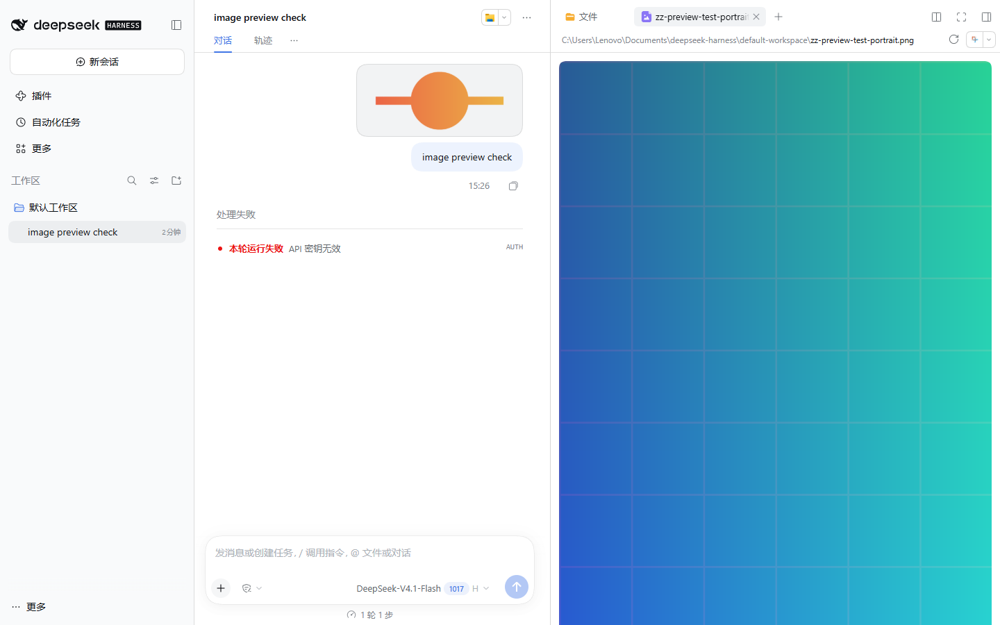
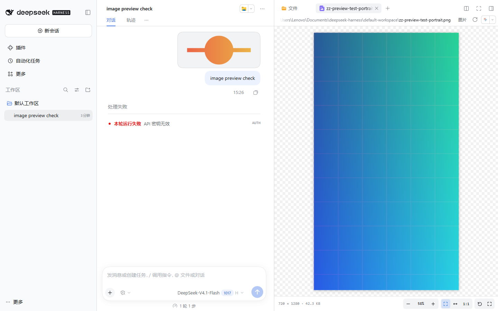
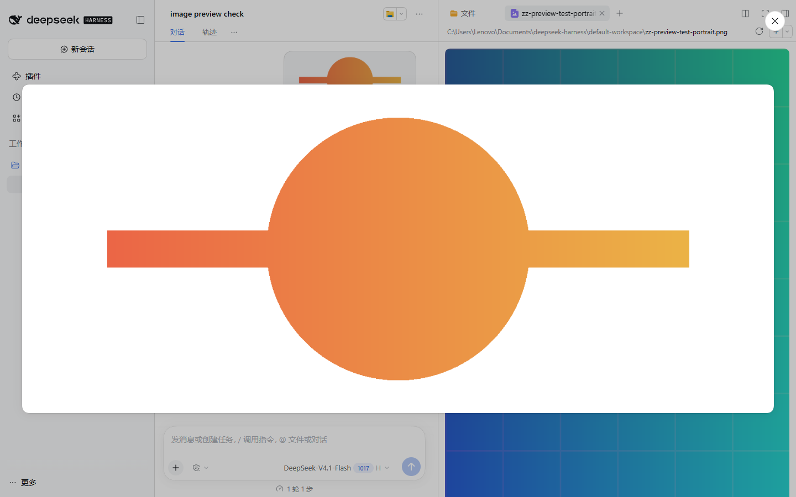
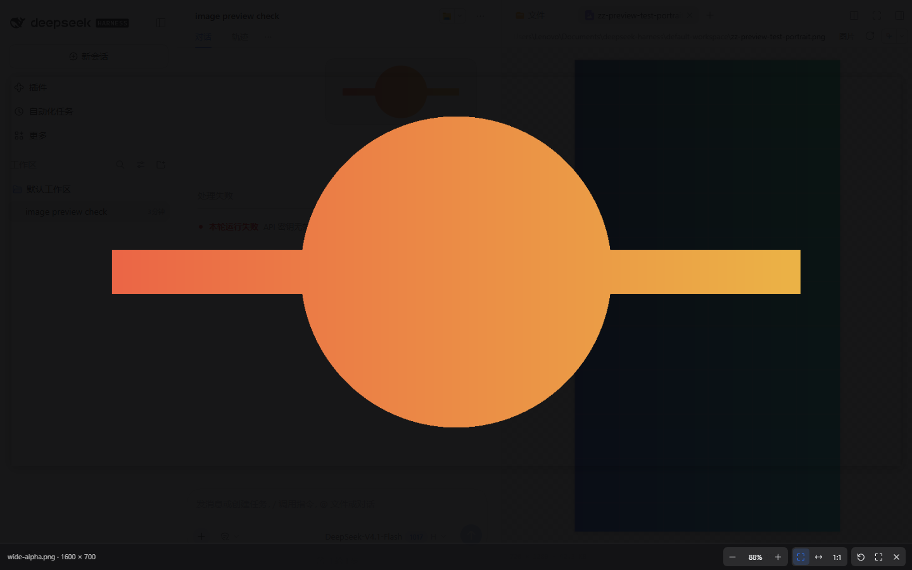
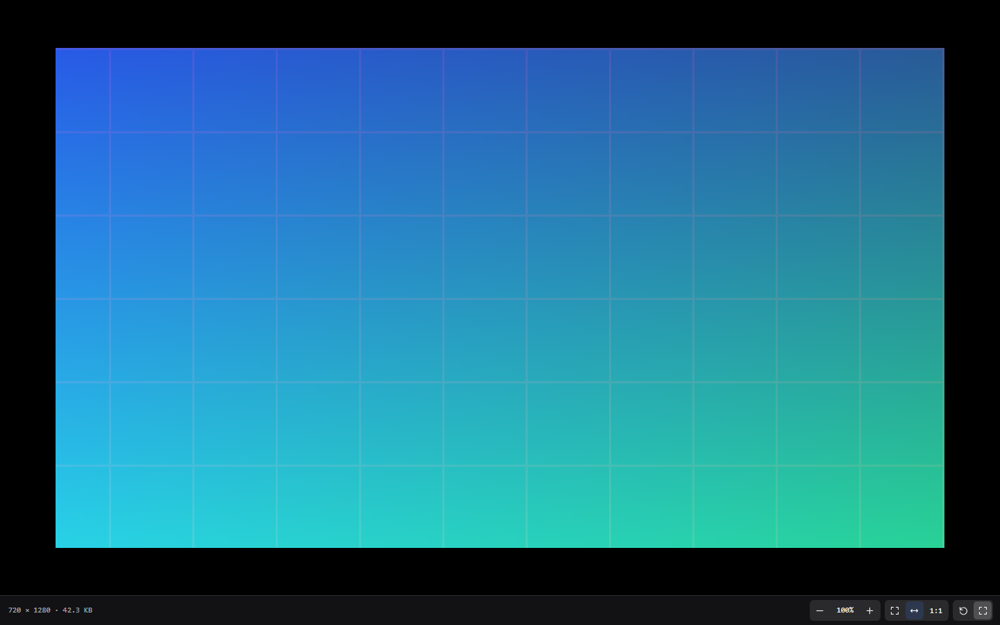
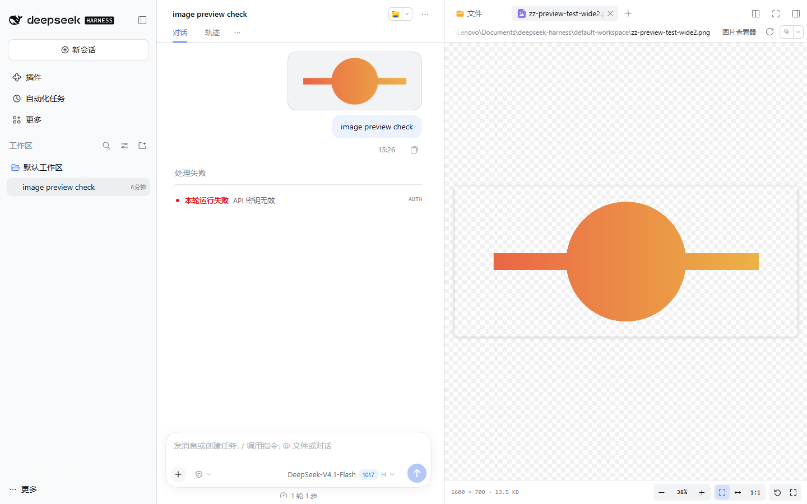

# dsh-preview-image

给 [DeepSeek Harness](https://github.com/deepseek-ai/deepseek-harness) 的图片预览补上**真正的缩放、拖动、旋转与全屏**：右侧栏文档预览和对话里的大图预览都能用。

[English](README.md) · **中文**（本文件）

## 为什么做

DSH 自带的两个图片预览都很克制：

- 文档预览里的图片渲染器只有一个浮在底部、鼠标移进去才出现的缩放控件（适应宽度 / 固定比例），没有旋转，也没有全屏。
- 对话里点击图片打开的是“原图预览”灯箱，只按视口大小显示原图、不能缩放——附件包自己的文档就把“灯箱没有缩放和下载”列为限制。

这个插件把两处都换成一个查看器：常驻工具栏提供缩放、适应、100%、旋转、全屏，另外支持滚轮 / 拖动 / 键盘。内置渲染器仍可从预览右上角的「打开方式」切回，SVG 也保留「纯文本」选项。

## 安装

```sh
dsh plugin --profile <profile> add dsh-preview-image
```

重启桌面端（profile 补丁在启动时读取）。没有配置项。

验证：从「文件」页签打开任意图片，右侧面板会出现常驻工具栏；点击对话里的图片或输入框里的附件缩略图，会打开可缩放的灯箱，而不是内置灯箱。

## 前后对照

同一会话、同一工作区、同一 1440×900 浅色视口。「之前」的 profile 是 `@deepseek-ai/dsh-base` + `@deepseek-ai/dsh-web-app`；「之后」在此基础上加装本插件。

### 右侧栏文档预览

| 之前 —— 内置图片渲染器 | 之后 —— dsh-preview-image |
|---|---|
|  |  |

内置视图让图片铺满面板、缩放控件藏起来；插件版本有常驻工具栏、尺寸与体积信息（720 × 1280 · 42.3 KB）、透明区域棋盘格和明确的按钮。

### 对话灯箱

| 之前 —— 只能适应视口 | 之后 —— 可缩放 |
|---|---|
|  |  |

### 全屏与透明背景

| 全屏（右上角最大化按钮） | 透明图片叠在棋盘格上 |
|---|---|
|  |  |

## 功能

- **文档渲染器**：以 `dsh-preview-image/viewer` 注册 `png`、`jpg`、`jpeg`、`jfif`、`gif`、`webp`、`avif`、`bmp`、`ico`、`svg`，`priority: "extension"`、`loading: "bytes-complete"`。位图声明为二进制、不再提供纯文本兜底；SVG 仍可读文本，保留纯文本选项。
- **对话灯箱**：在 `conversation.chat.user.images`、`conversation.chat.message.images`、`conversation.trajectory.images`、`tool.call.images`、`conversation.input.attachments` 这些槽位里的图片上截获点击，换成插件查看器。Esc、点背景、关闭按钮都能关，关闭后焦点回到打开它的图片按钮。
- **控件**：缩小、当前百分比（点击回到 100%）、放大、适应窗口、适应宽度、1:1、旋转 90°、全屏、关闭（灯箱）。工具栏常驻、窄面板自动换行；元数据显示原始尺寸，文档预览里还显示文件体积。
- **手势**：拖动平移，滚轮平移，Ctrl/⌘+滚轮以指针为中心缩放，双击在适应窗口与 100% 之间切换。Chromium 把触控板双指缩放映射成同一条 Ctrl+滚轮路径。
- **键盘**：`+`/`-` 缩放，`0` 适应，`1` 100%，`R` 旋转，`F` 全屏，方向键平移，`Esc` 退出全屏或关闭灯箱。文档查看器聚焦时接收按键；灯箱在窗口级监听。
- **全屏**：对查看器根节点调用 Fullscreen API；部署拒绝时退回固定定位的覆盖层，Esc 可退出。`Esc` 里也会主动调 `exitFullscreen()`，这样浏览器默认处理被抑制时快捷键仍然有效。
- **平移边界**：适应状态的小图始终完整可见；放大或旋转后的图不会被拖到完全离开视野。
- **透明背景**：舞台下层是低对比度棋盘格，透明 PNG 能看出来。

## 操作对照

| 动作 | 按钮 | 指针 | 键盘 |
|---|---|---|---|
| 放大 / 缩小 | − / + | Ctrl/⌘+滚轮 | `+` / `-` |
| 平移 | — | 拖动、滚轮、Shift+滚轮 | 方向键 |
| 适应窗口 | 适应图标 | 双击 | `0` |
| 适应宽度 | ⇔ 图标 | — | — |
| 实际大小（100%） | 百分比 / `1:1` | 双击 | `1` |
| 旋转 90° | ↻ 图标 | — | `R` |
| 全屏 | ⤢ 图标 | — | `F` |
| 关闭灯箱 | × | 点背景 | `Esc` |

## 配置

无。后缀列表、缩放范围（2%–1600%）与步进（1.25×）都是 `lib/client.js` 里的常量。

## 代码结构

```
lib/index.js    宿主半：name / inject / apply（纯客户端插件，不注册路由）
lib/client.js   手写 module-loader bundle：渲染器、body、灯箱、样式
test/           node --test：bundle 接线、缩放/平移纯函数、包形态
scripts/        无头浏览器端到端脚本（验证用）
docs/           前后对照截图
```

浏览器半是 `window.__ModuleLoader__.load({ id, factory })` 形式的经典 bundle，只 require `react`（灯箱 portal 另用 `react-dom`），不需要构建链，也不会与宿主 React 副本产生漂移。

## 开发

```sh
node --test test/*.test.js
```

端到端脚本需要：一个装好本插件的运行中宿主、一个带图片消息的会话、以及该会话工作区里的图片文件：

```sh
node scripts/e2e-browser.mjs --base "http://127.0.0.1:<port>/?token=<token>" \
  --session "<会话标题>" --file <图片文件名> --out <截图目录>
```

逐项打印 `PASS`/`FAIL`，有失败时以非零码退出。

## 已知限制

- **一次只显示一张。** 内置灯箱也是单张；没有画廊缩略条、下载或导出。
- **不支持把图片从面板里拖出去。** 拖动被用于平移；需要把原图拖进输入框时，可以从「打开方式」切回内置图片渲染器。
- **格式取决于浏览器。** AVIF、WebP、GIF、BMP、ICO、SVG 在 Chromium 里能解码；浏览器不支持的编码会显示查看器的失败状态。
- **只读完整文件。** 文档渲染器走 DSH 的完整文件读取，宿主的 `maxFileBytes` 上限与以前一致。
- **没有双指捏合。** Chromium 把触控板双指缩放变成 Ctrl+滚轮所以可用；触摸屏没有捏合处理。
- **旋转与适应状态按挂载重置。** 切换页签或刷新预览会回到适应窗口，与内置渲染器一致。
- 对话图片槽位之外的图片（例如助手消息里的 Markdown 内联图）不会打开这个灯箱，保持各自渲染器的行为。

## 许可证

MIT
